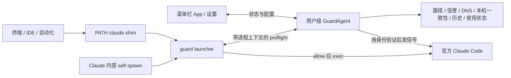

# 产品与技术设计

状态：架构与保护方向已获用户确认；评分修订为 `draft-2`；2026-11-11。研究依据见 [调研报告](../research/2026-11-11-findings.md)。

## 产品目标

用户继续输入 `claude`，本机在官方命令运行前检查此次进程环境；条件不满足时阻止启动。菜单栏持续显示 0–100 安全分，越高越安全。默认低于 80 分阻止启动，并对运行中受保护会话开始处置；相关检查无法完成时暂停放行。

这是一款**保守优先的环境检查与本地启动防护工具**。可持续采集的相关信号全部计分，通过权重区分轻重；轻微异常累积也能阻断。首发 macOS，CLI 是集成入口而非主要产品界面。首版保护本机官方 Claude Code；网页、其他设备和远端环境按覆盖矩阵单独显示。

## 三个核心组件



- **MenuBarApp**：SwiftUI + AppKit，显示状态、原因、设置和历史，不持有主决策逻辑。
- **GuardAgent**：用户级 LaunchAgent，采样、评分、缓存、策略、进程登记和事件处理；菜单栏窗口关闭不影响保护。
- **guard launcher / claude shim**：同一 Swift 可执行的两个入口模式，低延迟评估后 `exec` 官方命令，保留终端行为。

实现基线：macOS 13+；Swift；AppKit 菜单栏宿主与 SwiftUI 面板/设置；Network + SystemConfiguration 观察网络；版本化 JSON 保存有界本地历史；`SMAppService` 管理经用户批准的系统服务。macOS 13+ 的 CLI、Agent、App universal2 包结构已在 Apple Silicon 主机验证，Intel 与 macOS 13 实机仍属发行门禁。

选择全 Swift 可减少 GUI/后台/launcher 三种语言的维护成本。Rust 仍是未来跨平台核心的选项，但首发无必要先引入 FFI。Electron/Tauri 不作为本次建议技术栈。

## 命令包装与安装

### 双层接入

1. 安装独立的、位于 PATH 前部的 `claude` shim。
2. 对支持版本配置官方 `processWrapper` 或环境变量入口。
3. 对 IDE、LaunchAgent、CI/自动化提供稳定的 wrapper 绝对路径。
4. `guard doctor` 验证每个入口实际是否经过启动闸门。

示意路径：

```text
~/Library/Application Support/<Brand>/bin/claude       # PATH shim
~/Library/Application Support/<Brand>/bin/guard       # launcher + 管理命令
~/.local/bin/claude                                   # 官方维护，保留
```

shim 调用 `guard launch -- <resolved-official-binary> <argv...>`；官方 wrapper 模式接收官方传入的可执行路径与参数后直接进行相同 preflight，不再重新寻找 `claude`，避免循环。

真实路径通过排除本产品目录后的发现结果、安装来源和文件身份解析。每次启动复核官方入口的当前链接，不硬编码某个版本目录，不固定旧版本阻止升级。

**不覆盖** `~/.local/bin/claude`、Homebrew/npm 维护的链接。安装前展示待修改项；备份、合并用户设置，不覆盖已有企业 launcher；遇到已有 wrapper 需要组合协议验证，无法验证时标记冲突。卸载只删除自己管理的标记与仍等于自身值的配置，保留用户后续修改。

### launcher 契约

- 不读 stdin，stdout 完全留给官方命令，启动成功静默。
- 拦截原因按 launcher 模式写本地审计，并在安全的失败路径向 stderr 输出；机器模式提供稳定 JSON。
- 保留 argv/env/cwd、TTY 和 PID 的 exec 语义；不通过 shell 拼字符串执行参数。
- 不改变认证方式；不把 API key/OAuth token 发给 Agent 或检测端。
- 逐次检查嵌套 self-spawn；不得用可继承的 `GUARD_BYPASS=1` 免检全部子孙进程。
- 不以 `--help`、`--version` 等参数名作为可组合的通用绕过条件；维护命令豁免须为严格完整 argv allowlist，且在测试证明不会启动会话后才考虑。
- 官方入口需要约三秒内 exec：preflight 总预算建议 2.5 秒，超时严格模式 hold/拒绝本次启动并给出重试原因，不能为了等待第三方而卡死。

## 覆盖矩阵

| 启动路径 | V1 方案 | 保证边界 |
|---|---|---|
| 终端从 PATH 找 claude | shim | 需要 PATH 顺序正确、清除旧 shell hash/alias 冲突 |
| IDE/自动化从 PATH 启动 | shim + doctor | GUI 宿主未必继承 shell PATH |
| 自动化显式配置 guard 路径 | 稳定绝对路径 launcher | 本机支持入口可严格拒绝启动 |
| 内部后台服务/部分团队进程 | 官方 wrapper | 功能、版本、已有 supervisor 配置需逐项验证 |
| 直接调用官方二进制 | 不一定经过 shim | 可经官方 wrapper 覆盖其后续 self-spawn；顶层已绕过 |
| 深链接、部分 tmux/Chrome host | 部分缺口 | 根据官方文档分别显示，不声称已保护 |
| 已有未受管 Claude 进程 | 发现后提示接管/重启 | 不能追溯在启动前检查 |
| SSH 远端 / 容器 / 其他用户 | 不覆盖 | 将来需在目标执行环境部署 Agent/launcher |
| Claude 网页、移动端、Desktop Chat | 不覆盖 | 不使用菜单栏数字暗示整账号所有设备安全 |

用户若要求“任何入口、任何请求都不可绕过”，需增加 Endpoint Security / Network Extension 的独立技术验证与权限申请，不能通过更多 alias 达成。

## 实际进程上下文与路径探测

`LaunchContext` 至少包含：调用 UID/PID/进程启动时间、原命令身份、Claude 版本/安装来源、cwd 对应配置作用域、认证提供商类型、代理和 `NO_PROXY` 的有效配置、TLS 配置摘要。**不发送完整环境变量或命令正文**。

评分修订后增加最小化环境元数据：系统/进程 TZ、有效 locale、系统首选语言与区域格式、时间同步状态、可验证 runtime/OS，以及可读取的当前模型/记忆开关等状态。模型、记忆、认证失败计数等先由阶段 01 验证采集适配；只传状态和计数，不传正文或凭据。完整字段与扣分见 [64 项检测清单](check-catalog.md)。

有代理口令时仅在本机内存传递最少探测凭据，禁止日志落盘；配置摘要使用带本地密钥的 HMAC，避免对口令做可离线枚举的普通哈希。密钥放 Keychain；企业配置不可读时为 unknown。

Agent 与 launcher 共享有版本的配置解析器，以 Claude 当前版本的优先级计算有效设置。不能只读取进程环境而忽略用户、项目、托管设置和宿主行为。解析器版本未知、配置冲突或 provider 为未知网关时，knowledge 降级，严格模式不猜测放行。

探测分三层：

1. **本地确定性检查**：有效代理、NO_PROXY 匹配、路由/接口、DNS/地址族、TLS 开关和文件配置。
2. **进程等价路径检查**：显式使用相同代理配置和信任设置，对需要的目标域名做低频无凭据 TLS/HTTP 可达性检查；401/403 也要区分已连通和业务拒绝。不发送模型推理请求，不调用未公开账号接口。
3. **出口/信誉检查**：对可用的目标诊断路径或自有 echo 观测端测出口，再用可替换授权供应商查地区/ASN/信誉。第三方检测端可能看到用户 IP，需要在 onboarding 说明。

原生网络库不一定与 Claude runtime 的 CA、代理和 DNS 行为相同。必须用可观测的本地 HTTP CONNECT 测试代理验证等价性；企业 CA/mTLS 无法等价探测时不读取私钥来补齐，改标“此路径未完整验证”。

独立 echo、claude.ai trace 和 API 域名分别保存观测，不互相替代。严格路径锁定使用验证通过的目的域名级适配器；缺少必要路径数据时扣完整度分并 hold。

用户使用 Bedrock、其他官方支持 provider、自有网关时，按 provider 单独选域名和适用策略，不拿 Anthropic 消费者账号的指标直接扣它的分。首版优先认证本地直连官方 Claude 服务这一场景；其余显示“未完成适配”。

## 新鲜度、事件与性能

- 每次启动重新构造 context、校验 networkEpoch、规则版本和 TTL，重新计算当前决策。不是直接读取菜单栏上一次数字。
- 当前路径观测建议 TTL 5 秒；信誉按供应商建议缓存约 6 小时；历史从本地立即获取。任何网络/代理/设置变化立即让相关缓存失效。
- 多个同时启动共享同一 `contextID + networkEpoch` 的 in-flight 探测，防止启动风暴；缓存必须还区分 provider、目标、地址族和探测适配器版本。
- `NWPathMonitor`、SystemConfiguration 动态通知、有效设置文件变化和睡眠唤醒触发事件；仅凭 NWPathMonitor 不能知道所有代理程序的规则更新。
- 有活跃会话时建议每 30 秒低频路径复核；无会话时每 5 分钟；网络事件立即复核，信誉不按秒请求。
- 启动目标：热路径 p95 <150ms；需联网但能在预算内完成的 p95 <2 秒；2.5 秒硬超时。均为待实测目标。
- 空闲 CPU 目标 <0.5%，Agent + GUI 内存目标 <100MB；记录机型、系统和测量窗口后验收。

网络状态可能在检测和 exec 之间再次变化。ticket 绑定 context、networkEpoch、规则版本、PID/启动时间，建议有效 1 秒，exec 前再次比对本地代次并登记。仍不能在普通用户态消除 TOCTOU 或原子保证“执行开始前没有任何包”。

## IPC 与数据

V1 推荐用户私有 Unix domain socket，目录 0700、socket 0600，校验 peer UID，并尽可能取得 peer PID/启动时间；只监听本机。长度前缀帧、最大消息长度、协议版本、超时和请求幂等键。第三方自动化通过已签名 launcher 接入，GUI/Agent 也校验自身组件签名。

这可以隔离其他 UID，但不是对同 UID 恶意程序的完整安全边界；本工具面向意外环境变化，不将“用户自己主动绕过”当作已解决的威胁。

接口草案：

```text
GetStatus(contextID?)
Preflight(LaunchContext, deadline) -> Decision + findings + short-lived ticket
RegisterPendingExec(ticket, peerPID, processStartTime)
UpdatePolicy(expectedVersion, changes)
SubscribeEvents(lastEventID)
GetHistory(filter, cursor)
```

登记在 exec 前完成；Agent 后续以相同 PID/启动时间验证 executable 已切换。二进制替换、进程退出和 PID 重用都要失效。只发送用户能理解且可执行的最小信息。

当前实现将历史保存为版本化 JSON，使用单用户目录和 `0600` 文件权限。上下文指纹与出口地址使用 Keychain 中的本地密钥计算 HMAC 摘要；原始 IP、代理凭据、代理 URL、地理坐标和完整环境不落盘。国家码、ASN、采样时间和有限风险标记以明文存储。历史样本窗口为 24 小时，单上下文最多 512 个样本、最多 128 个上下文、总样本最多 5,000 条；用户可以清除历史。诊断导出采用独立白名单，不导出本地历史或自由文本。该文件没有整体加密，文件权限和字段最小化是当前保护边界。

## 运行中处置与故障

精确动作见 [评分契约](scoring-and-policy.md)。Agent 仅控制登记或用户明确纳入管理且身份确认的 Claude 进程，不用 `pkill -f claude`，不终止浏览器或 shell。

发现未受管进程单独显示“1 个未受保护会话”；如用户选择“管理本用户全部本机 Claude Code”，接管时仍需确认 executable/UID，不按进程显示名推断。子工具可能有独立生命周期，终止 Claude 不等于取消远端副作用。

关闭弹窗、退出菜单栏 UI 与停止防护是不同操作；后者明确告知保护会失效。Agent 崩溃由 launchd 尽力重启，新启动默认拒绝；**已在运行的会话在 Agent 故障窗口内 V1 无法保证暂停/结束**，恢复后立即复核。不要为掩盖这一缺口临时加多重 watchdog。

退出 launcher 保留官方子进程状态；launcher 自身拒绝建议使用 `EX_CONFIG(78)`，临时不可验证使用 `EX_TEMPFAIL(75)`，找不到官方命令使用 127。它们是本工具命令契约，不保证上层自动化一定识别；机器输出用稳定 `reasonCode`。

## 规则维护与发行

“实时”分成两件事：本机观测按事件更新；政策与社区检测规则经维护者整理成结构化规则后发布。客户端定时检查规则版本，不自行把网页内容当作可执行规则。

社区经验可以直接转化为检测规则；发布前验证可采集性、触发与扣分、去重及回滚，不要求先取得官方确认。规则库包含逐项权重和一致性映射，不采用只覆盖四类粗指标的实现。

首版内置带版本规则和官方来源目录，不要求用户注册本产品账号。远程规则订阅可后续加入：签名 JSON、schema、来源、生效时间、到期时间、回放验证、灰度、回滚；规则不含任意代码/命令。过期适用范围规则显示 unknown，不自动变成允许。

首版通过 Developer ID 签名、公证的 DMG 分发，后续可加 Homebrew cask。App、helper 与 launcher 做统一版本协议并允许短期相邻版本兼容。升级/卸载需可恢复 PATH 与用户设置。发行包包含 arm64 与 x86_64 的 universal2 App、CLI、Agent 和 helper；Intel 实机与各 macOS 版本仍须通过发行验收后才能列入正式支持范围。

## 首版取舍

**包含：**菜单栏数字与健康、上下文列表、启动前检查、官方 wrapper 集成、阈值、受管会话退出、网络变化事件、解释/历史、doctor、可逆安装和卸载、签名发行。

**推迟：**系统扩展级强制拦截、跨设备账号评分、浏览器扩展、自动改时区/语言/代理、支付身份分析、抓包解密、服务端账户状态扫描、云端账号/遥测平台。

实施顺序见 [长期计划](../plans/2026-11-11/environment-guard/progress.md)。先验证“路径能否代表 Claude、包装入口是否实际覆盖、三秒 launcher 契约”三个关键假设，再正式实现 UI。
